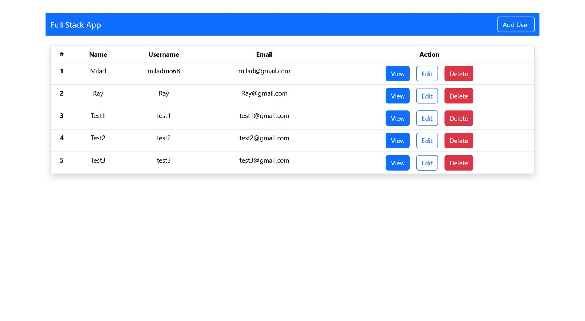

<div align="center">

# 👔 Full-Stack Employee Management

A CRUD employee manager with a React and Bootstrap frontend and a Spring Boot, Hibernate and MySQL API.

<a href="https://github.com/miladmo68/Fullstack-Employment"></a>
<a href="https://miladweb.com"></a>

</div>

<p align="center">
  
</p>

## ✨ Features

- Add, edit, view and delete users
- Spring Boot REST API with Hibernate
- MySQL database
- Bootstrap UI

## 🛠️ Tech Stack

       

> [!NOTE]
> This project needs its own backend, database or API keys, so it runs locally rather than as a static demo.

## 🚀 Getting Started

**Prerequisites:** [Node.js](https://nodejs.org/) 18 or newer · Java 17+ (the Maven wrapper is included) · A running MySQL server

**Clone**

```bash
git clone https://github.com/miladmo68/Fullstack-Employment.git
cd Fullstack-Employment
```

**Backend (fullstack-employment)**

```bash
cd fullstack-employment
./mvnw spring-boot:run
```

**fullstack-front**

```bash
cd fullstack-front
npm install
npm run dev
```

## 📡 API Endpoints

| Method | Path |
| --- | --- |
| `POST` | `/user` |
| `GET` | `/users` |
| `GET` | `/user/{id}` |
| `PUT` | `/user/{id}` |
| `DELETE` | `/user/{id}` |

## 📁 Project Structure

```
Fullstack-Employment/
├── fullstack-employment/
└── fullstack-front/
```

## 👤 Author

**Milad Mohammadi** — Frontend-Focused Full-Stack Developer, Toronto 🇨🇦

[](https://miladweb.com)
[](https://www.linkedin.com/in/miladmo68/)
[](https://github.com/miladmo68)

<p align="center"><sub>If you like this project, consider giving it a ⭐</sub></p>
